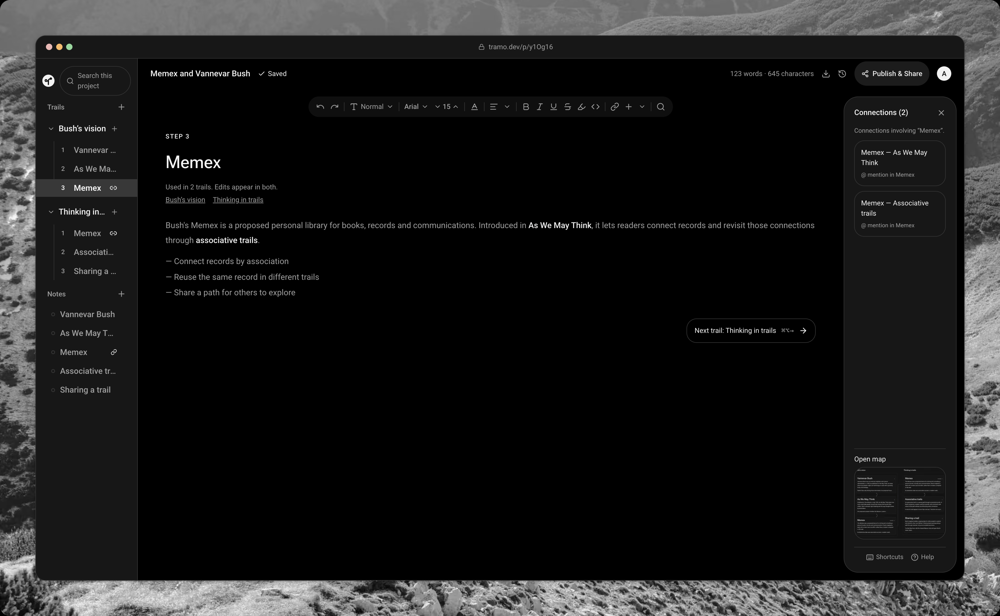

  

<h1 align="center">Tramo — Web</h1>

  <b>Publish the path of your thinking.</b> 
  <a href="https://tramo.dev">tramo.dev</a> ·
  <a href="https://tramo.dev/explore">Explore</a> ·
  <a href="https://tramo.dev/wiki/getting-started">Wiki</a> ·
  <a href="https://tramo.dev/changelog">Changelog</a>

  
  
  
  
  

  

Frontend for **Tramo**, a Memex-inspired tool for writing connected, reusable notes.
Projects group notes and **trails**: ordered sequences of notes for learning,
explaining and sharing ideas.

Built with Next.js 16, React 19, TypeScript and Lexical.

## Documentation

- [Setup](docs/setup.md): requirements, environment variables and running locally.
- [Architecture](docs/architecture.md): notes, trails, connections, stack and layout.
- [Testing](docs/testing.md): tests, checks and browser verification